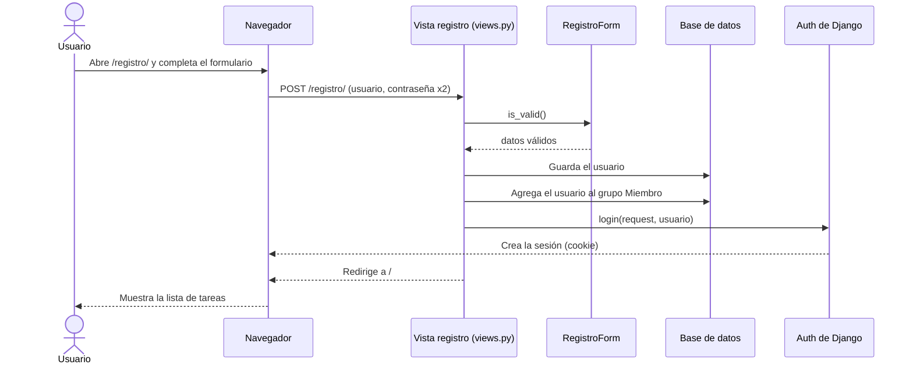
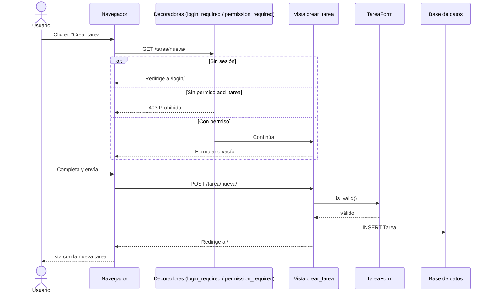

# Diagrama de secuencia — Primera versión

Pegar cada bloque en https://mermaid.live y exportar como PNG para el SRS.

## 1. Registro e inicio de sesión

## 2. Crear una tarea (con control de permisos)

