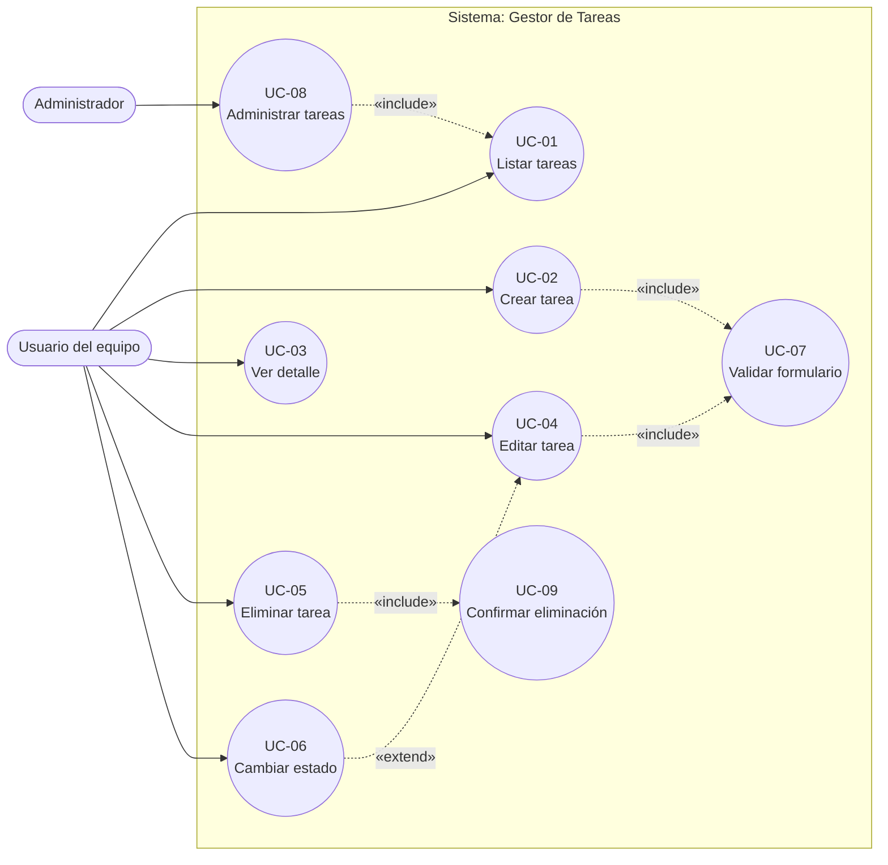
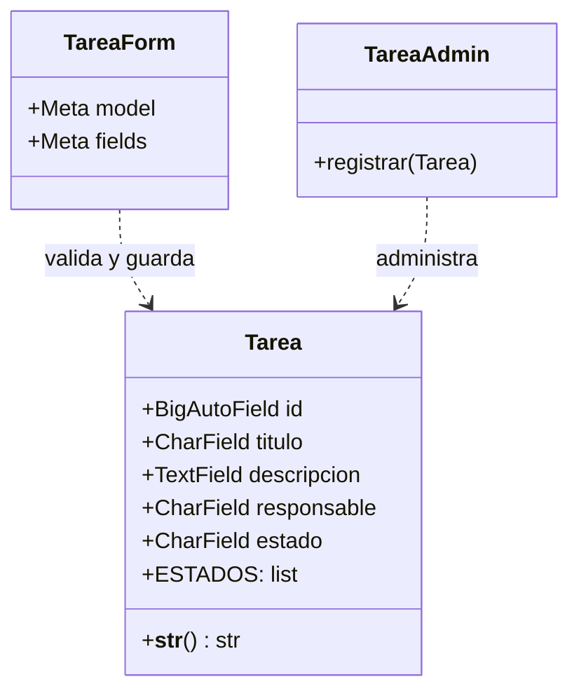
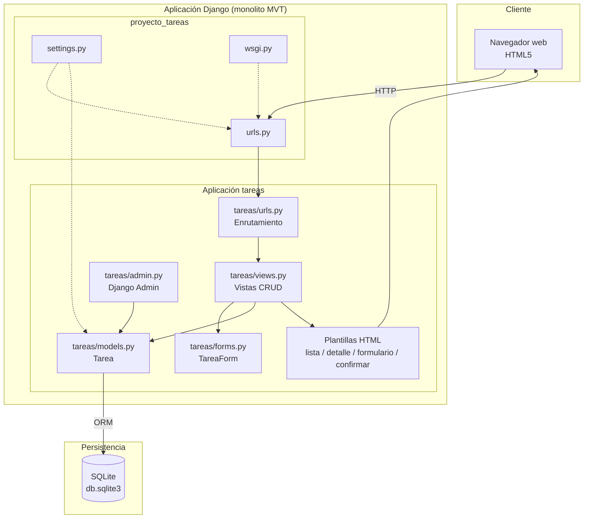
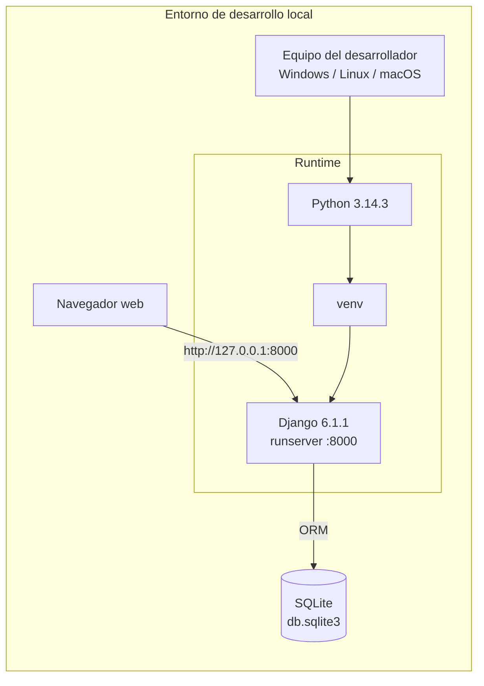
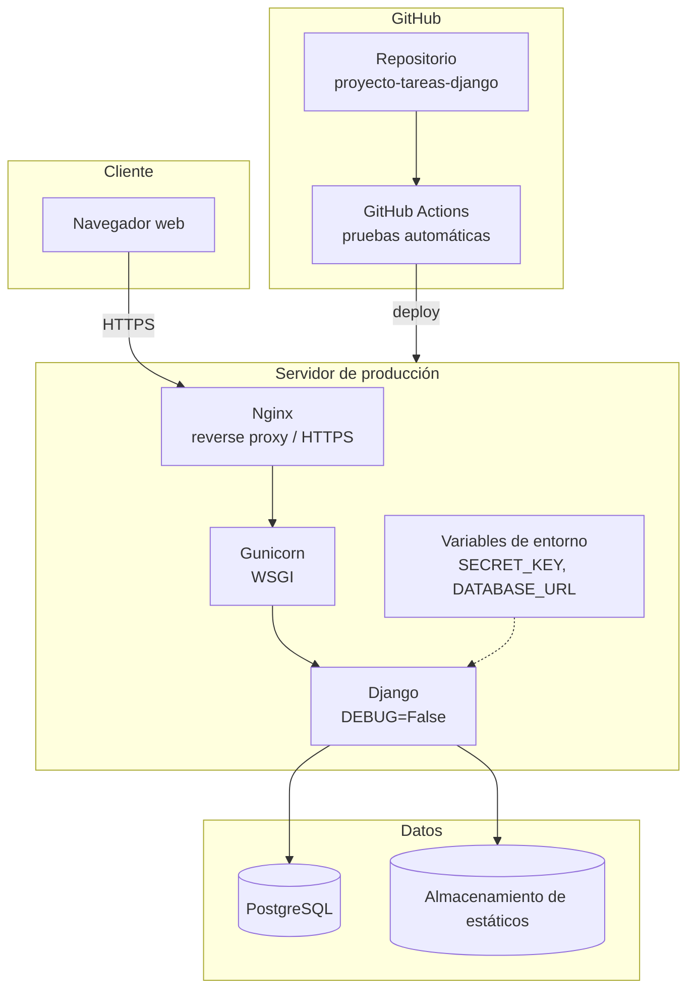
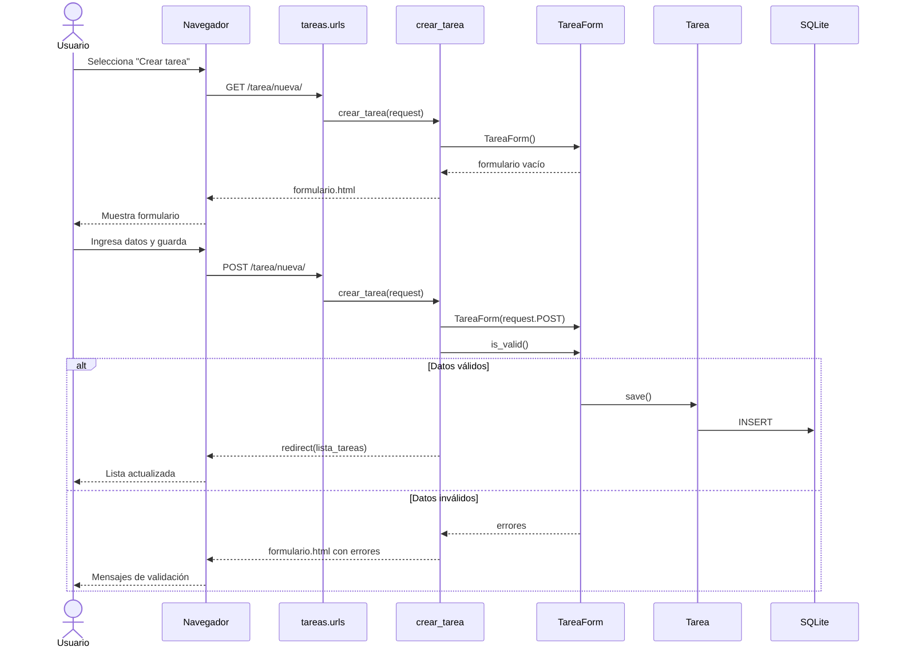
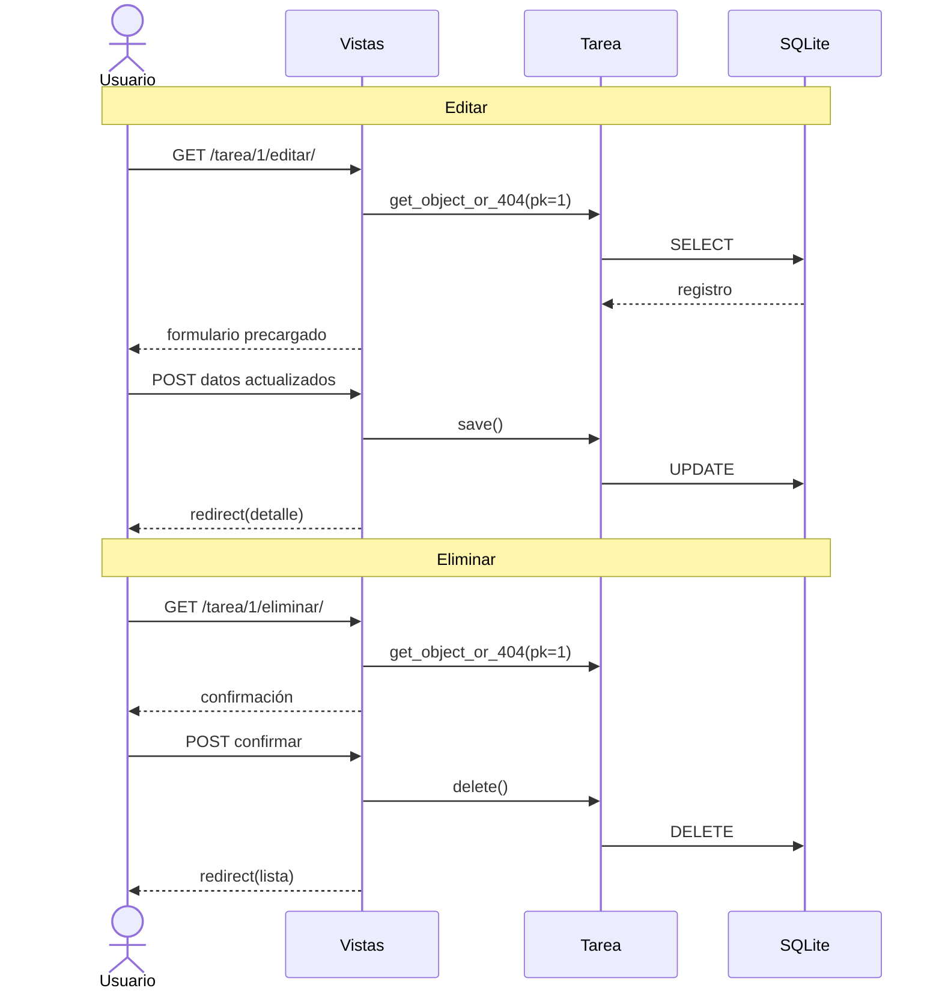
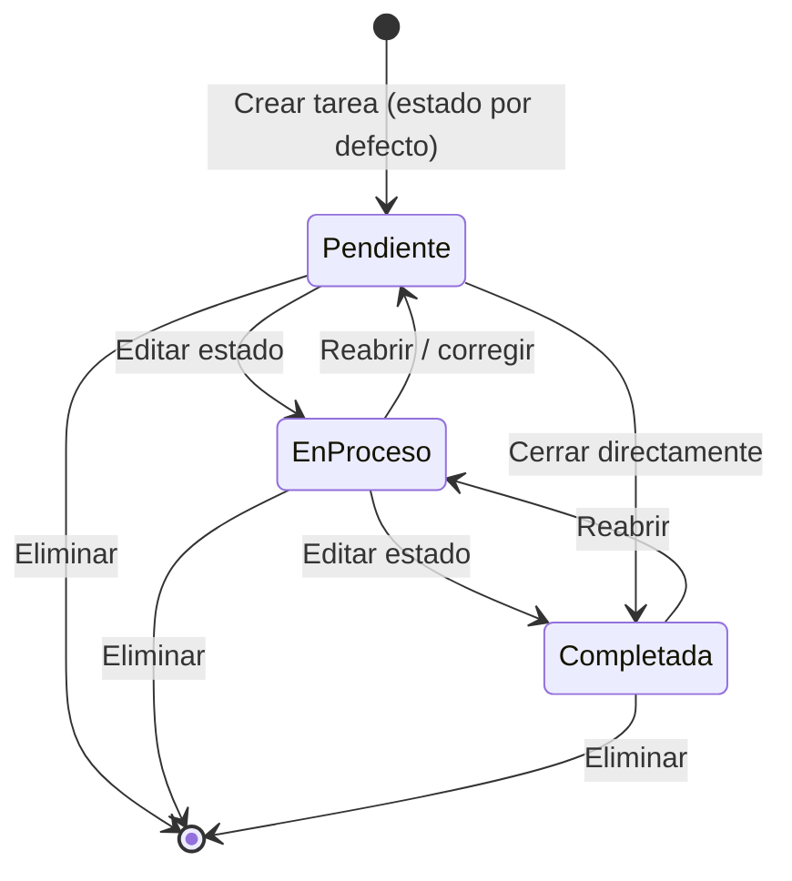
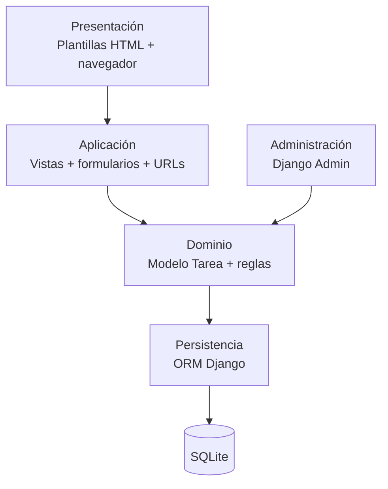

# Diagramas UML iniciales

**Proyecto:** Gestor de Tareas de Equipo (`proyecto_tareas`)
**Versión:** 1.0
**Herramienta:** Mermaid (se visualiza en GitHub, GitLab, Obsidian, VS Code y https://mermaid.live)

Los diagramas describen el MVP actual y marcan con notas la evolución prevista. Cada diagrama se acompaña de una breve explicación para la sustentación.

---

## 1. Diagrama de casos de uso

### 1.1 Diagrama

### 1.2 Explicación

- El **Usuario del equipo** es el actor principal y ejecuta las operaciones CRUD.
- El **Administrador** usa el panel de Django para supervisar y depurar datos.
- **UC-07 Validar formulario** es incluido por crear y editar: no existe como pantalla independiente, pero es obligatorio en ambos flujos.
- **UC-09 Confirmar eliminación** es incluido por eliminar: protege contra borrados accidentales.
- **UC-06 Cambiar estado** extiende la edición, porque en el MVP se realiza desde el mismo formulario.
- **UC-08 Administrar tareas** incluye la consulta de tareas desde el admin.

### 1.3 Actores y correspondencia con el código

| Caso de uso | Vista / componente |
|---|---|
| UC-01 Listar | `tareas.views.lista_tareas` → `lista.html` |
| UC-02 Crear | `tareas.views.crear_tarea` → `formulario.html` |
| UC-03 Ver detalle | `tareas.views.detalle_tarea` → `detalle.html` |
| UC-04 Editar | `tareas.views.editar_tarea` → `formulario.html` |
| UC-05 Eliminar | `tareas.views.eliminar_tarea` → `confirmar_eliminacion.html` |
| UC-06 Cambiar estado | `TareaForm` + `Tarea.ESTADOS` |
| UC-07 Validar | `TareaForm` |
| UC-08 Administrar | `tareas.admin` |
| UC-09 Confirmar | `confirmar_eliminacion.html` + `POST` |

---

## 2. Diagrama de clases

### 2.1 Diagrama

### 2.2 Explicación

- `Tarea` es la única entidad persistente del MVP.
- `TareaForm` es un `ModelForm` que valida y persiste instancias de `Tarea`.
- `TareaAdmin` representa el registro del modelo en Django Admin.
- `ESTADOS` es una lista de tuplas que restringe los valores posibles.

### 2.3 Atributos y restricciones

| Atributo | Tipo | Restricción |
|---|---|---|
| `id` | BigAutoField | Clave primaria |
| `titulo` | CharField | Máximo 100, obligatorio |
| `descripcion` | TextField | Obligatorio |
| `responsable` | CharField | Máximo 50, obligatorio |
| `estado` | CharField | 20 caracteres, opciones cerradas, por defecto `pendiente` |

---

## 3. Diagrama de componentes

### 3.1 Diagrama

### 3.2 Explicación

- El navegador consume HTML generado por las plantillas.
- `proyecto_tareas.urls` incluye `tareas.urls` y monta el admin.
- Las vistas orquestan formularios, modelos y plantillas.
- El ORM de Django aísla el acceso a SQLite.
- `settings.py` provee configuración transversal; `wsgi.py` es el punto de entrada para servidores de producción.

### 3.3 Responsabilidades

| Componente | Responsabilidad | Archivo |
|---|---|---|
| Configuración | Ajustes, apps, middleware, base de datos | `proyecto_tareas/settings.py` |
| Rutas raíz | Admin y delegación a la app | `proyecto_tareas/urls.py` |
| Rutas de tareas | Mapa URL → vista | `tareas/urls.py` |
| Vistas | Lógica de los casos de uso | `tareas/views.py` |
| Formularios | Validación y renderizado | `tareas/forms.py` |
| Modelo | Entidad y reglas de estado | `tareas/models.py` |
| Admin | Gestión administrativa | `tareas/admin.py` |
| Plantillas | Presentación HTML | `tareas/templates/tareas/` |
| Persistencia | Almacenamiento relacional | `db.sqlite3` |

---

## 4. Diagrama de despliegue

### 4.1 Entorno actual de desarrollo

### 4.2 Despliegue propuesto a futuro

### 4.3 Explicación

- **Ahora:** todo corre en el equipo del desarrollador; el navegador se conecta al servidor de desarrollo y SQLite almacena los datos en un archivo local.
- **Futuro:** el código se publica en GitHub, las pruebas se ejecutan en Actions y el despliegue usa Gunicorn detrás de Nginx, con PostgreSQL y secretos en variables de entorno.
- La migración de SQLite a PostgreSQL no requiere cambios en las vistas, gracias al ORM.

### 4.4 Nodos y artefactos

| Nodo | Artefactos |
|---|---|
| Equipo del desarrollador | Código fuente, `venv`, `db.sqlite3` |
| Navegador | HTML, CSS, formularios |
| Servidor Django (dev) | `manage.py`, app `tareas`, plantillas |
| GitHub | Repositorio, issues, pull requests, Actions |
| Servidor de producción (futuro) | Nginx, Gunicorn, Django, variables de entorno |
| Base de datos (futuro) | PostgreSQL |

---

## 5. Diagrama de secuencia: crear tarea

---

## 6. Diagrama de secuencia: editar y eliminar

---

## 7. Diagrama de estados de una tarea

### 7.1 Explicación

Los tres estados están definidos en `Tarea.ESTADOS`. El modelo no impone un orden estricto de transición: cualquier estado puede cambiarse a cualquier otro mediante la edición. El diagrama representa las transiciones recomendadas, no una restricción técnica.

---

## 8. Diagrama de arquitectura en capas

---

## 9. Resumen para la sustentación

1. **Casos de uso:** el usuario gestiona tareas; el administrador supervisa.
2. **Componentes:** monolito Django con separación MVT y app `tareas`.
3. **Despliegue:** hoy local con SQLite; futuro en GitHub + Nginx + Gunicorn + PostgreSQL.
4. **Clases:** una entidad `Tarea` y un `ModelForm`.
5. **Secuencia:** las vistas coordinan validación, persistencia y renderizado.
6. **Estados:** pendiente, en proceso y completada.

> Para exportar los diagramas: abra este archivo en VS Code con la extensión Mermaid, o pegue cada bloque en https://mermaid.live y descargue PNG/SVG.
